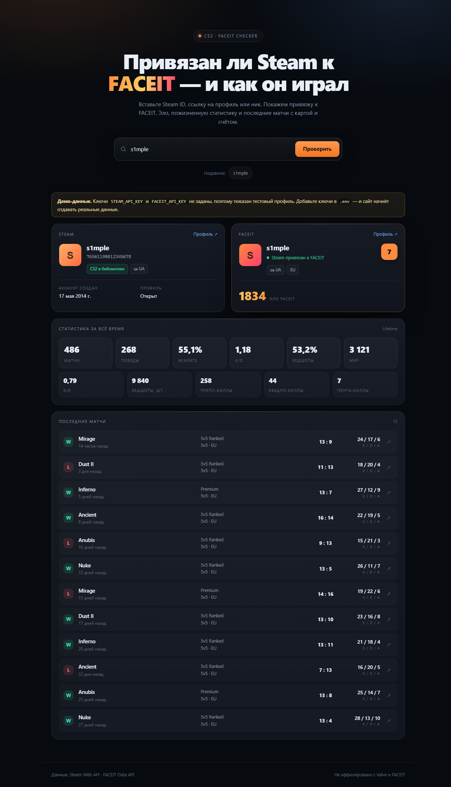
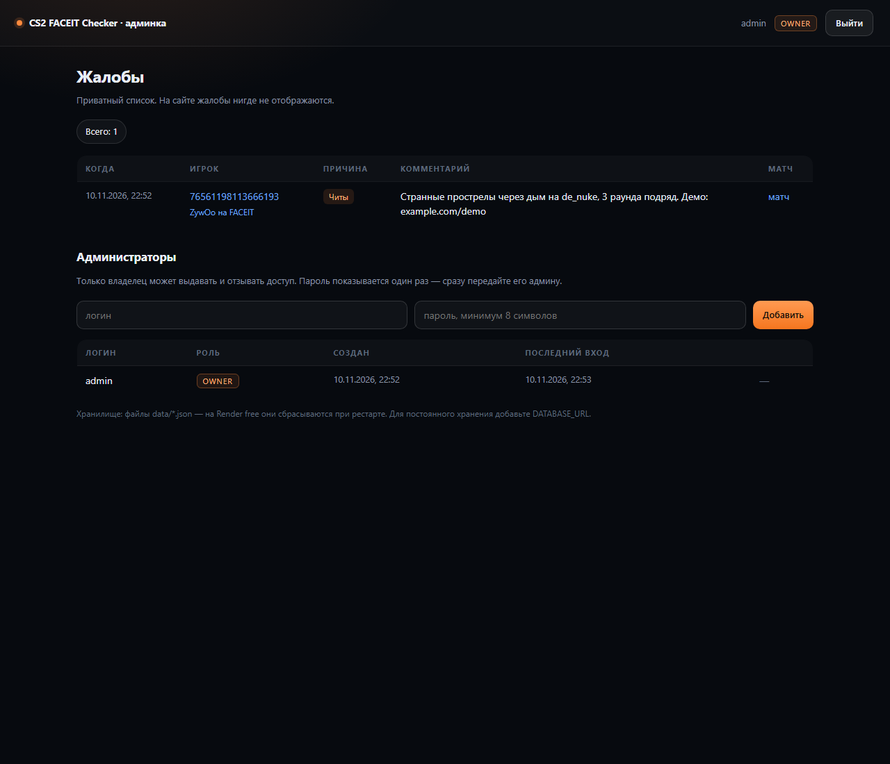
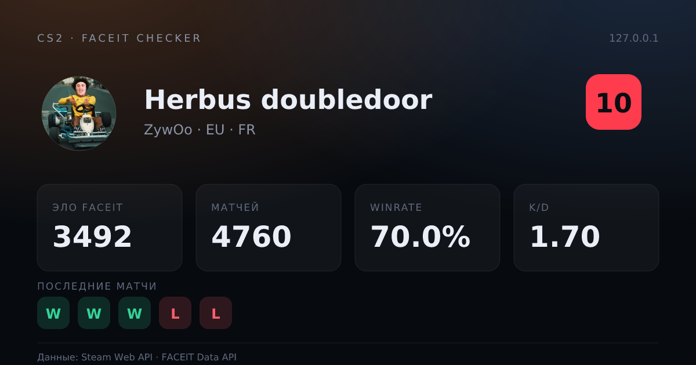

# CS2 FACEIT Checker

Одностраничный сервис: вставляешь Steam ID — видишь, **привязан ли аккаунт к FACEIT**, Эло, пожизненную статистику и последние матчи CS2.



## Что умеет

- **Ищет по любому виду ID**: `steamcommunity.com/profiles/…`, `steamcommunity.com/id/…`, steamID64, `STEAM_1:0:…`, `[U:1:…]`, короткий account id.
- **Steam**: ник, аватар, дата регистрации, открыт ли профиль, есть ли CS2 в библиотеке.
- **FACEIT**: привязка (да / нет / не проверено), ник, Эло, уровень 1–10, регион, страна.
- **Статистика за всё время**: матчи, победы, winrate, K/D, K/R, хедшоты, MVP, мультикиллы.
- **Последние матчи**: карта, счёт, победа/поражение, K/D/A, ссылка в комнату FACEIT.
- **Демо-режим**: без ключей сайт работает на тестовых данных — можно посмотреть и оценить до настройки.
- **Кэш и rate limit**: не долбит чужие API и не упирается в лимиты.

## Стек

React 19 + TypeScript + Vite на фронте, Express 4 на бэке. Без UI-библиотек, без БД, без ORM.

Бэкенд обязателен: ключи Steam и FACEIT должны жить **только на сервере**, иначе их украдут и заблокируют.

## Быстрый старт

```bash
pnpm install
cp .env.example .env      # Windows: copy .env.example .env
# вписать STEAM_API_KEY и FACEIT_API_KEY
pnpm dev
```

- UI: http://localhost:5173
- API: http://localhost:8787

Без ключей ничего не падает: `/api/lookup` отдаёт демо-данные, а в интерфейсе висит плашка «Демо-данные».

### Прод

```bash
pnpm build
pnpm start        # Express раздаёт dist/ и /api на одном порту
```

### Где взять ключи

| Ключ | Где | Зачем |
| --- | --- | --- |
| `STEAM_API_KEY` | [steamcommunity.com/dev/apikey](https://steamcommunity.com/dev/apikey) | ник, аватар, библиотека игр |
| `FACEIT_API_KEY` | [developers.faceit.com](https://developers.faceit.com/) → My apps → создать приложение → **Server-side API key** | привязка Steam, Эло, матчи |

## API

```
GET /api/health
→ { "ok": true, "steamKey": true, "faceitKey": true, "demoForced": false }

GET /api/lookup?q=<steam id | ссылка | ник>&matches=12
→ {
    "demo": false,
    "fetchedAt": "2026-11-10T15:00:00.000Z",
    "query": "s1mple",
    "steamId64": "76561198034202275",
    "steam": { "personaName": "s1mple", "avatar": "…", "cs2Owned": true, "createdAt": "…" },
    "faceit": { "linked": true, "nickname": "s1mple", "elo": 3200, "level": 10, "region": "EU" },
    "lifetime": { "matches": 486, "wins": 268, "winRate": 55.1, "kd": 1.18, "hsPercent": 53.2 },
    "matches": [ { "map": "de_mirage", "score": "13 : 9", "result": "win", "kills": 24, "deaths": 17 } ],
    "warnings": []
  }
```

`faceit` может быть `{ "linked": false }` (аккаунт не привязан) или `{ "linked": null, "reason": "no_key" | "error" }`.

Коды ошибок: `400` — не распознали ID, `429` — больше 60 запросов в минуту с одного IP, `502` — внешний сервис не ответил.

```
POST /api/reports
{ "steamId64": "7656119…", "nickname": "…", "matchId": "1-…", "reason": "cheats|smurf|toxic|other",
  "comment": "…", "deviceId": "uuid из localStorage" }
→ 201 { "ok": true }
→ 409 { "duplicate": true }   — с этого устройства уже жаловались на игрока
→ 400 / 429
```

## Жалобы и админка

Кнопка «Пожаловаться» на карточке FACEIT открывает форму: причина, необязательная привязка к конкретному матчу, комментарий. Жалоба **никуда не публикуется** — её видно только в админке.

### Доступ



Админка закрыта логином и паролем:

- владелец создаётся автоматически из `ADMIN_LOGIN` и `ADMIN_PASSWORD` при каждом старте (меняешь пароль в env — меняется и в базе);
- владелец заходит на `/admin/login` и попадает в панель;
- в панели владелец видит список жалоб **и** блок «Администраторы», где добавляет и удаляет других админов;
- обычный админ видит только жалобы — управление доступами ему недоступно (сервер отвечает `403`);
- владельца удалить нельзя, иначе можно потерять доступ навсегда.

Сессия — подписанный HMAC cookie (`HttpOnly`, `SameSite=Lax`, 7 дней), поэтому в базе не хранятся токены. Удалённый админ теряет сессию сразу: на каждый запрос его запись перепроверяется в базе.

### Защита

- пароли — `scrypt` со случайной солью, сравнение через `timingSafeEqual`;
- вход ограничен 10 попытками за 10 минут с одного IP;
- при несуществующем логине проверка пароля всё равно выполняется (заглушка), чтобы по времени ответа нельзя было определить, есть ли такой админ;
- формы защищены проверкой `Origin`/`Referer` (CSRF);
- всё пользовательское содержимое экранируется при рендере.

### Накрутка жалоб

- одна жалоба с устройства на игрока — `UNIQUE (target_steam_id, reporter_hash)`, повтор возвращает `409`;
- идентификатор устройства приходит из `localStorage` и хешируется с солью, сырой id не хранится;
- не больше 8 жалоб за 10 минут с одного IP.

### Хранение

Если задан `DATABASE_URL` — Postgres (переживает рестарт и деплой), иначе файлы `data/*.json`. На Render free файлы сбрасываются при перезапуске: жалобы и добавленные админы пропадут, владелец пересоздастся из env.

## Карточка игрока и шаринг



- `/player/<steamid64>` — страница профиля. Сервер отдаёт её с готовыми `og:`-метатегами, поэтому ссылка в Discord и Telegram разворачивается карточкой с ником, Эло и уровнем, а не голым URL.
- `/player/<steamid64>/card.png` — картинка 1200×630 для превью и сториз.
- `/player/<steamid64>/badge.svg` — компактный бейдж 300×88 для подписей на форумах (вставляется как `` и ведёт на профиль).

Карточка рисуется из SVG через `@resvg/resvg-js`. Шрифты лежат в `server/fonts` и передаются рендереру явно — на Linux-хостинге без установленных шрифтов иначе получились бы пустые квадраты вместо текста. Готовые картинки кешируются в памяти на 10 минут и отдаются с `Cache-Control: public, max-age=600`.

## Как проверяется привязка FACEIT

```
GET https://open.faceit.com/data/v4/players?game=cs2&game_player_id=<steamID64>
```

- `200` — Steam-аккаунт привязан к FACEIT, в ответе профиль игрока;
- `404` — не привязан;
- если `cs2` не нашёлся, пробуем `csgo` — у старых аккаунтов игра до сих пор числится под старым id.

Дальше по найденному `player_id` тянутся `/players/{id}/stats/cs2` (объект `lifetime`), `/players/{id}/history` (последние матчи), а карта и K/D/A — из `/matches/{id}/stats` (по одному запросу на матч, с кэшем на сутки).

## Ограничения, о которых честно

- **Ключ FACEIT обязателен.** Data API не отдаёт привязку и статистику анонимно. Регистрация приложения бесплатная, но у ключа есть лимиты запросов — отсюда кэш и `MATCH_LIMIT`.
- **Steam-библиотека видна только при открытом профиле.** Если игры скрыты, сайт честно пишет «Библиотека скрыта», а не выдумывает ответ.
- **Чужой приватный профиль не «пробить».** Всё, что показывается, отдают сами Steam и FACEIT.
- **Соблюдайте условия FACEIT.** Ключ — только на сервере, без перепродажи данных и без обхода лимитов. Это не официальный продукт FACEIT и не аффилирован с Valve.

## Структура

```
server/
  index.mjs      Express: API, статика, rate limit, маршруты админки
  lookup.mjs     сборка ответа из Steam + FACEIT, graceful degradation
  steam.mjs      Steam Web API: vanity, профиль, библиотека
  faceit.mjs     FACEIT Data API: привязка, статистика, история, матчи
  steamid.mjs    разбор любых форматов Steam ID
  http.mjs       fetch с таймаутом и одним ретраем
  util.mjs       TTL-кэш и ограниченная параллельность
  demo.mjs       демо-данные без ключей
  db.mjs         Postgres или JSON-файлы, общее хранилище
  reports.mjs    жалобы и дедуп по устройству
  admins.mjs     админы: владелец из env + добавленные
  auth.mjs       scrypt-пароли, подписанные cookie-сессии
  admin.mjs      серверный рендер страницы входа и панели
  card.mjs       карточка игрока: SVG → PNG (resvg)
  badge.mjs      бейдж для форумов (SVG)
  pages.mjs      HTML профиля с og-метатегами
  fonts/         DejaVu Sans (чтобы текст на карточке рисовался всегда)
src/
  App.tsx        состояние, поиск, история запросов, синк с URL
  reported.ts    пометка «жалоба отправлена» в localStorage
  components/    карточки Steam/FACEIT, статистика, матчи, форма жалобы
  styles.css     тёмная тема, адаптив
```

## Деплой на Render

В репозитории лежит `render.yaml` — это Blueprint, Render сам создаст сервис с нужными настройками.

1. Залей проект в репозиторий на GitHub.
2. Render → **New → Blueprint** → выбери репозиторий → **Apply**.
3. Render спросит `STEAM_API_KEY` и `FACEIT_API_KEY` — вставь их в форму. Это переменные окружения, в код и в репозиторий они не попадают.
4. Через 2–3 минуты сайт будет на `https://<имя>.onrender.com`. Проверка — `/api/health`, он покажет `{"ok":true,"steamKey":true,"faceitKey":true}`.

Ручная настройка, если Blueprint не подходит:

- Runtime: **Node**
- Build command: `pnpm install --frozen-lockfile --ignore-scripts && pnpm build`
- Start command: `node server/index.mjs`
- Health check path: `/api/health`
- Переменные: `STEAM_API_KEY`, `FACEIT_API_KEY`, `MATCH_LIMIT=12`, `NODE_VERSION=22`, `ADMIN_LOGIN=admin`, `ADMIN_PASSWORD` (пароль владельца админки), при желании `DATABASE_URL` от Neon — тогда жалобы и админы не теряются при рестарте.

Особенности Render:

- **Free-план засыпает** через ~15 минут без запросов, первый запрос после сна — 30–60 секунд. Для проверки работы этого достаточно.
- Сервер слушает `0.0.0.0` и берёт порт из `PORT` — обе вещи Render задаёт сам, поэтому локальный запуск и деплой не конфликтуют.
- Включён `trust proxy`, иначе rate limit видел бы один IP прокси на всех посетителей.
- Файловая система эфемерна: кэш живёт в памяти и сбрасывается при рестарте — для этих данных это нормально.
- `--ignore-scripts` в сборке нужен из-за политики pnpm 10+: esbuild ставится и без postinstall (проверено), а падать из-за неподтверждённого скрипта не должен.

Чистый static-хостинг (Netlify, GitHub Pages) не подойдёт: ключи нельзя отдавать в браузер, значит нужен Node-процесс.

## Что можно докрутить

- график Эло по матчам (нужна история глубже `/history`);
- сравнение двух игроков бок о бок;
- Redis вместо кэша в памяти, если инстансов больше одного;
- рейтинг друзей / лидерборд по Эло.
